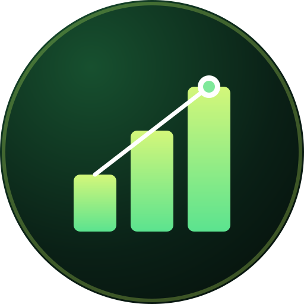

# FINN: your trusted investment companion

- **App:** https://finn-lake.vercel.app (open on a phone, tap *Try as guest*)
- **Repo:** https://github.com/b740562-dev/FINN
- **AI build history:** https://drive.google.com/drive/folders/19HHuMHoBANV9AafT-QEO9J-40Ma-Cbtd?usp=sharing

**Point of view:** an investor's scarce resource is attention. So FINN shows what changed as numbers and pictures, ranks everything by how much it matters to *your* money, and folds the rest away.

## What I built

- **Push (Today + Alerts):** a ranked digest for any window (24h / 7d / 30d, or replay a past date). Results become a Revenue / EBITDA / PBT / PAT card (QoQ and YoY), a management change shows the incoming person's bio, a new concall adds its key takeaway, and routine filings collapse into one line. Alerts fire on price and volume moves against thresholds the user sets, with the ₹ impact on their position.
- **Pull (Research):** works on any NSE ticker, using only the company's own reports and reported numbers. It covers a snapshot, **promise vs delivered** (guidance from the last four concalls scored against actuals), a health check and bull vs bear. Every claim links to its source.
- **Surya:** a chat and voice guide. General advice is free-form, but company facts come only from verified documents, and Surya says so when it doesn't know.
- **Mobile PWA:** a guest account in one tap, then Google or email sign-in. The demo portfolio has 20 companies across 18 sectors and all three sizes.

## Key decisions and trade-offs

1. **Cheap where possible, smart where needed.** 57% of filings are classified by rules with no AI. Bulk work runs on `gemini-3.5-flash-lite`, and only reasoning uses `gemini-3.6-flash`, with every answer cached. The whole build would cost **$1.04** at paid rates; it ran at ₹0 on the free tier.
2. **The model extracts, code judges.** Importance is computed, for example as an order's share of revenue or a fund raise's share of market cap. The ranking is explainable.
3. **No unchecked numbers.** Every number in a summary must appear in its source. This caught a 10× crore/million slip, and it flags filings whose text disagrees with the reported table.
4. **Honest data access.** BSE blocks automated downloads, and FINN doesn't imitate a browser. It reads what it can on its own (13 of the first 62 reports); the rest are a one-tap upload.

## Left out, deliberately

Intraday data and news, web push notifications, buy or sell calls, and imitating a browser to scrape exchange sites.

## Next

A licensed exchange data feed (so no report ever needs a manual upload), alerts on WhatsApp or push, a ranking that learns from what each investor opens, and an evaluation set to measure the AI's accuracy.

*Full detail: [full write-up](https://github.com/b740562-dev/FINN/blob/main/docs/WRITEUP.md) · [README](https://github.com/b740562-dev/FINN#readme) · [decision log](https://github.com/b740562-dev/FINN/blob/main/DECISIONS.md)*
